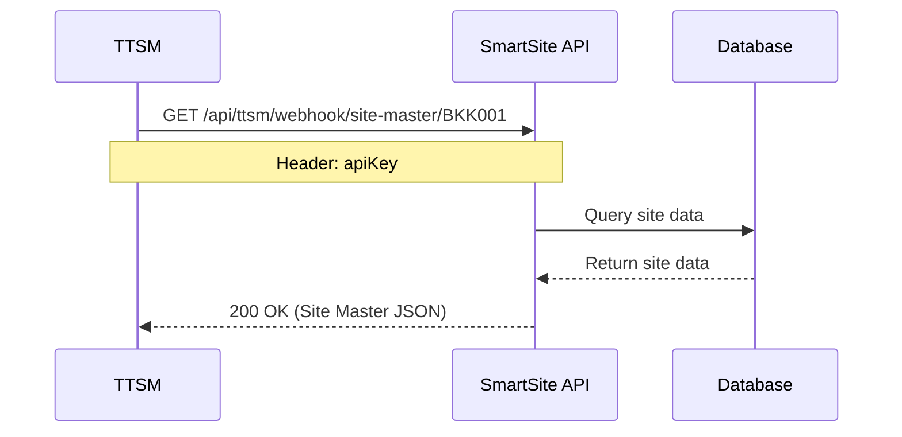
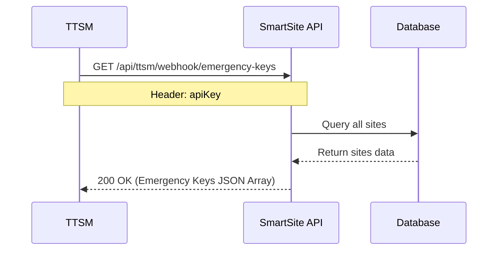
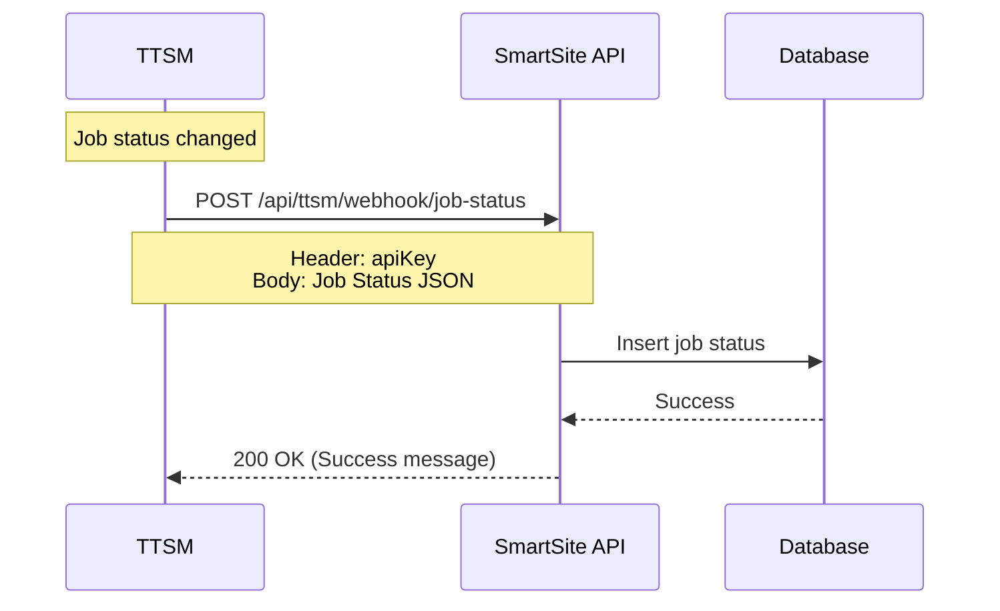

# TTSM Integration API Specification

**Document Version:** 1.0
**Last Updated:** 2025-02-17
**System:** SmartSite Application Server

---

## 📌 Overview

เอกสารนี้อธิบาย API Endpoints ที่ TTSM ต้องเรียกใช้งานเพื่อดึงข้อมูลจาก SmartSite Application Server

### Base URL
```
Production: https://your-domain.com
Development: http://localhost:8080
```

### Authentication
ทุก request ต้องส่ง API Key ผ่าน HTTP Header:
```
apiKey: {your_api_key_here}
```

---

## 🔐 Authentication & Security

### API Key Header
```http
apiKey: your_secret_api_key
```

### Error Response (401 Unauthorized)
```json
{
  "success": false,
  "message": "Invalid API Key"
}
```

### Error Response (404 Not Found)
```json
{
  "success": false,
  "message": "Site not found: BKK001"
}
```

### Error Response (500 Internal Server Error)
```json
{
  "success": false,
  "message": "Error: {error_details}"
}
```

---

# 📡 API Endpoints

## 1. Get Site Master Data

ดึงข้อมูล Site Master ของ site ที่ระบุ

### Endpoint
```
GET /api/ttsm/webhook/site-master/{siteCode}
```

### Request Headers
| Header | Type | Required | Description |
|--------|------|----------|-------------|
| apiKey | string | Yes | API Key สำหรับยืนยันตัวตน |

### Path Parameters
| Parameter | Type | Required | Description | Example |
|-----------|------|----------|-------------|---------|
| siteCode | string | Yes | รหัส Site | BKK001 |

### Request Example
```http
GET /api/ttsm/webhook/site-master/BKK001 HTTP/1.1
Host: your-domain.com
apiKey: your_secret_api_key
```

### Response (200 OK)
```json
{
  "siteCode": "BKK001",
  "siteName": "Site Bangkok 1",
  "siteAddress": "123 ถนนสุขุมวิท แขวงคลองเตย เขตคลองเตย กรุงเทพมหานคร 10110",
  "latitude": "13.736717",
  "longitude": "100.523186",
  "province": "กรุงเทพมหานคร",
  "district": "คลองเตย",
  "subDistrict": "คลองเตย",
  "emergencyKey": "ABC123XYZ789DEF456",
  "emergencyKeyUpdatedAt": "2025-02-17 10:30:00",
  "status": "ONLINE",
  "lastUpdated": "2025-02-17 11:00:00",
  "appVersion": null,
  "firmwareVersion": null
}
```

### Response Fields
| Field | Type | Description |
|-------|------|-------------|
| siteCode | string | รหัส Site (unique) |
| siteName | string | ชื่อ Site (ภาษาไทย) |
| siteAddress | string | ที่อยู่ Site |
| latitude | string | ละติจูด (GPS) |
| longitude | string | ลองจิจูด (GPS) |
| province | string | จังหวัด |
| district | string | อำเภอ/เขต |
| subDistrict | string | ตำบล/แขวง |
| emergencyKey | string | Emergency Key (Site Key) |
| emergencyKeyUpdatedAt | string | วันที่อัพเดท Emergency Key (format: yyyy-MM-dd HH:mm:ss) |
| status | string | สถานะ Site (ONLINE, OFFLINE, UNKNOWN, etc.) |
| lastUpdated | string | วันที่อัพเดทข้อมูลล่าสุด (format: yyyy-MM-dd HH:mm:ss) |
| appVersion | string | เวอร์ชัน Application (nullable) |
| firmwareVersion | string | เวอร์ชัน Firmware (nullable) |

### cURL Example
```bash
curl -X GET "https://your-domain.com/api/ttsm/webhook/site-master/BKK001" \
  -H "apiKey: your_secret_api_key"
```

---

## 2. Get Emergency Keys

ดึงข้อมูล Emergency Keys (Site Keys) ของ site ทั้งหมด หรือ site ที่ระบุ

### Endpoint
```
GET /api/ttsm/webhook/emergency-keys
```

### Request Headers
| Header | Type | Required | Description |
|--------|------|----------|-------------|
| apiKey | string | Yes | API Key สำหรับยืนยันตัวตน |

### Query Parameters
| Parameter | Type | Required | Description | Example |
|-----------|------|----------|-------------|---------|
| siteCode | string | No | รหัส Site (ถ้าต้องการเฉพาะ site) | BKK001 |

### Request Example 1: ดึงทั้งหมด
```http
GET /api/ttsm/webhook/emergency-keys HTTP/1.1
Host: your-domain.com
apiKey: your_secret_api_key
```

### Request Example 2: ดึงเฉพาะ Site
```http
GET /api/ttsm/webhook/emergency-keys?siteCode=BKK001 HTTP/1.1
Host: your-domain.com
apiKey: your_secret_api_key
```

### Response (200 OK) - All Sites
```json
[
  {
    "siteCode": "BKK001",
    "siteName": "Site Bangkok 1",
    "siteAddress": null,
    "latitude": null,
    "longitude": null,
    "province": null,
    "district": null,
    "subDistrict": null,
    "emergencyKey": "ABC123XYZ789DEF456",
    "emergencyKeyUpdatedAt": "2025-02-17 10:30:00",
    "status": null,
    "lastUpdated": null,
    "appVersion": null,
    "firmwareVersion": null
  },
  {
    "siteCode": "BKK002",
    "siteName": "Site Bangkok 2",
    "siteAddress": null,
    "latitude": null,
    "longitude": null,
    "province": null,
    "district": null,
    "subDistrict": null,
    "emergencyKey": "XYZ789ABC123GHI456",
    "emergencyKeyUpdatedAt": "2025-02-17 09:15:00",
    "status": null,
    "lastUpdated": null,
    "appVersion": null,
    "firmwareVersion": null
  }
]
```

### Response (200 OK) - Single Site
```json
{
  "siteCode": "BKK001",
  "siteName": "Site Bangkok 1",
  "siteAddress": null,
  "latitude": null,
  "longitude": null,
  "province": null,
  "district": null,
  "subDistrict": null,
  "emergencyKey": "ABC123XYZ789DEF456",
  "emergencyKeyUpdatedAt": "2025-02-17 10:30:00",
  "status": null,
  "lastUpdated": null,
  "appVersion": null,
  "firmwareVersion": null
}
```

### cURL Example - All Sites
```bash
curl -X GET "https://your-domain.com/api/ttsm/webhook/emergency-keys" \
  -H "apiKey: your_secret_api_key"
```

### cURL Example - Single Site
```bash
curl -X GET "https://your-domain.com/api/ttsm/webhook/emergency-keys?siteCode=BKK001" \
  -H "apiKey: your_secret_api_key"
```

---

## 3. Send Job Status (Webhook)

TTSM ส่งข้อมูล Job Status มายัง SmartSite Application Server เพื่อแจ้งสถานะงานของช่างเทคนิค

### Endpoint
```
POST /api/ttsm/webhook/job-status
```

### Request Headers
| Header | Type | Required | Description |
|--------|------|----------|-------------|
| apiKey | string | Yes | API Key สำหรับยืนยันตัวตน |
| Content-Type | string | Yes | application/json |

### Request Body
```json
{
  "siteCode": "BKK001",
  "jobId": "JOB20250217001",
  "jobType": "TT_ONSITE",
  "jobStatus": "IN_PROGRESS",
  "isOnsite": 1,
  "technicianName": "สมชาย ใจดี",
  "technicianPhone": "0812345678",
  "jobStartTime": "2025-02-17T08:00:00",
  "jobEndTime": null,
  "remarks": "กำลังเข้าไปตรวจสอบ site"
}
```

### Request Body Fields
| Field | Type | Required | Description | Example |
|-------|------|----------|-------------|---------|
| siteCode | string | Yes | รหัส Site | BKK001 |
| jobId | string | No | รหัส Job | JOB20250217001 |
| jobType | string | No | ประเภท Job | TT_ONSITE, MAINTENANCE, REPAIR |
| jobStatus | string | No | สถานะ Job | PENDING, IN_PROGRESS, COMPLETED, CANCELLED |
| isOnsite | integer | No | ช่างอยู่ onsite หรือไม่<br>0 = Unknown<br>1 = Onsite<br>2 = Not onsite | 1 |
| technicianName | string | No | ชื่อช่างเทคนิค | สมชาย ใจดี |
| technicianPhone | string | No | เบอร์โทรช่าง | 0812345678 |
| jobStartTime | datetime | No | เวลาเริ่มงาน (ISO 8601) | 2025-02-17T08:00:00 |
| jobEndTime | datetime | No | เวลาจบงาน (ISO 8601) | 2025-02-17T12:00:00 |
| remarks | string | No | หมายเหตุ | กำลังเข้าไปตรวจสอบ site |

### Request Example
```http
POST /api/ttsm/webhook/job-status HTTP/1.1
Host: your-domain.com
apiKey: your_secret_api_key
Content-Type: application/json

{
  "siteCode": "BKK001",
  "jobId": "JOB20250217001",
  "jobType": "TT_ONSITE",
  "jobStatus": "IN_PROGRESS",
  "isOnsite": 1,
  "technicianName": "สมชาย ใจดี",
  "technicianPhone": "0812345678",
  "jobStartTime": "2025-02-17T08:00:00",
  "jobEndTime": null,
  "remarks": "กำลังเข้าไปตรวจสอบ site"
}
```

### Response (200 OK)
```json
{
  "success": true,
  "message": "Job status received"
}
```

### Job Status Values
| Value | Description |
|-------|-------------|
| PENDING | รองาน (ยังไม่ได้เริ่ม) |
| IN_PROGRESS | กำลังดำเนินการ |
| COMPLETED | เสร็จสิ้น |
| CANCELLED | ยกเลิก |

### Job Type Values
| Value | Description |
|-------|-------------|
| TT_ONSITE | งาน TT Onsite |
| MAINTENANCE | งานบำรุงรักษา |
| REPAIR | งานซ่อมแซม |
| INSTALLATION | งานติดตั้ง |

### isOnsite Values
| Value | Description |
|-------|-------------|
| 0 | ไม่ทราบสถานะ |
| 1 | ช่างอยู่ที่ site |
| 2 | ช่างไม่อยู่ที่ site |

### cURL Example - Job Started
```bash
curl -X POST "https://your-domain.com/api/ttsm/webhook/job-status" \
  -H "apiKey: your_secret_api_key" \
  -H "Content-Type: application/json" \
  -d '{
    "siteCode": "BKK001",
    "jobId": "JOB20250217001",
    "jobType": "TT_ONSITE",
    "jobStatus": "IN_PROGRESS",
    "isOnsite": 1,
    "technicianName": "สมชาย ใจดี",
    "technicianPhone": "0812345678",
    "jobStartTime": "2025-02-17T08:00:00",
    "jobEndTime": null,
    "remarks": "กำลังเข้าไปตรวจสอบ site"
  }'
```

### cURL Example - Job Completed
```bash
curl -X POST "https://your-domain.com/api/ttsm/webhook/job-status" \
  -H "apiKey: your_secret_api_key" \
  -H "Content-Type: application/json" \
  -d '{
    "siteCode": "BKK001",
    "jobId": "JOB20250217001",
    "jobType": "TT_ONSITE",
    "jobStatus": "COMPLETED",
    "isOnsite": 2,
    "technicianName": "สมชาย ใจดี",
    "technicianPhone": "0812345678",
    "jobStartTime": "2025-02-17T08:00:00",
    "jobEndTime": "2025-02-17T12:00:00",
    "remarks": "ตรวจสอบเรียบร้อยแล้ว"
  }'
```

---

# 🔄 Integration Flow

## Flow 1: TTSM Pull Site Master Data



## Flow 2: TTSM Pull Emergency Keys



## Flow 3: TTSM Push Job Status (Webhook)



---

# 📊 Use Cases

## Use Case 1: ดึงข้อมูล Site เมื่อต้องการอัพเดท Master

**เมื่อ:** TTSM ต้องการอัพเดทข้อมูล Site Master
**ทำ:** TTSM เรียก `GET /api/ttsm/webhook/site-master/{siteCode}`
**ได้:** ข้อมูล Site ล่าสุดจาก SmartSite

## Use Case 2: ดึง Emergency Keys ทุกวัน

**เมื่อ:** TTSM ต้องการ sync Emergency Keys ทุกวัน
**ทำ:** TTSM เรียก `GET /api/ttsm/webhook/emergency-keys`
**ได้:** Emergency Keys ของทุก Site

## Use Case 3: แจ้งสถานะช่างเข้า Site

**เมื่อ:** ช่างเข้าถึง Site เพื่อทำงาน
**ทำ:** TTSM ส่ง `POST /api/ttsm/webhook/job-status` พร้อม `isOnsite: 1`
**ได้:** SmartSite บันทึกสถานะและไม่ส่ง Alarm ซ้ำ

## Use Case 4: แจ้งสถานะงานเสร็จ

**เมื่อ:** ช่างทำงานเสร็จและออกจาก Site
**ทำ:** TTSM ส่ง `POST /api/ttsm/webhook/job-status` พร้อม:
- `jobStatus: "COMPLETED"`
- `isOnsite: 2`
- `jobEndTime: {timestamp}`

**ได้:** SmartSite ปรับสถานะและกลับมาส่ง Alarm ปกติ

---

# 🧪 Testing Guide

## Test Scenario 1: Get Site Master

### Test Data
```
Site Code: BKK001
API Key: test_api_key_123
```

### Expected Result
- Status Code: 200
- Response contains: siteCode, siteName, emergencyKey, etc.

## Test Scenario 2: Invalid API Key

### Test Data
```
API Key: invalid_key
```

### Expected Result
- Status Code: 401
- Response: {"success": false, "message": "Invalid API Key"}

## Test Scenario 3: Site Not Found

### Test Data
```
Site Code: NOTEXIST
API Key: test_api_key_123
```

### Expected Result
- Status Code: 404
- Response: {"success": false, "message": "Site not found: NOTEXIST"}

## Test Scenario 4: Send Job Status

### Test Data
```json
{
  "siteCode": "BKK001",
  "jobId": "TEST_JOB_001",
  "jobStatus": "IN_PROGRESS",
  "isOnsite": 1
}
```

### Expected Result
- Status Code: 200
- Response: {"success": true, "message": "Job status received"}

---

# 📞 Support & Contact

**Development Team:**
- Email: dev-team@example.com
- Phone: 02-xxx-xxxx

**API Issues:**
- Create issue at: https://github.com/your-org/smartsite/issues

**Emergency Contact:**
- On-call: 08x-xxx-xxxx

---

# 📝 Change Log

| Version | Date | Changes |
|---------|------|---------|
| 1.0 | 2025-02-17 | Initial API Specification |

---

**End of Document**
